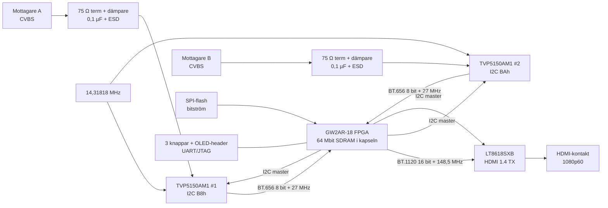

# Rev A — koncept för eget mixing- och HDMI-kort (utkast 2026-10-01)

> **Ändrat 2026-10-02:** Rev A är nu ett **dekoderkort** (2× TVP5150AM1 → stiftlist), schema i `rev_a/` — se `rev_a/README.md`. FPGA och HDMI-utgång väljs efter prov på devkort; nya kandidater är **ADV7513** (fullt dokumenterad) och **GW5A-25 utan HDMI-sändare** (serialiserare 2 000 Mbit/s räcker för 1080p60), se `../research/ALTERNATIVA_VAGAR_2026-10-02.md`. Det här dokumentet beskriver det integrerade kortet, som nu blir rev B.
>
> **Rättelse:** "en oscillator till båda XTAL1" nedan fungerar bara med en **1,8 V**-oscillator — XTAL1 tål högst 2,3 V (SLES209E, absoluta maxvärden). Dekoderkortet har en kristall per dekoder.

Status: koncept för diskussion. Inget schema ritat, inget beställt. Källor: `research/raw/reva/` (TI TVP5150AM1-datablad, Gowin DS226 GW2AR, Sipeed Tang Nano 20K-datablad, Lontium LT8618SX-brief), LCSC-sökningar 2026-10-01, samt `research/DEKODRAR_KUNSKAPSUNDERLAG_2026-09-30.md`.

## Mål för rev A

- Två analoga videoingångar från två mottagare på samma VTX-kanal.
- Avkoda båda samtidigt, mixa rad för rad (algoritm i `design/GATEWARE_PLAN.md`).
- Bildbuffert (≈ 1 bild) → stabil **1080p60 HDMI** med standardtiming, även när den analoga signalen fallerar.
- Arbetsmål latens ≈ ≤ 50 ms glas-till-glas (README).
- Kunna utvecklas stegvis: samma gateware körs först på Tang Nano 20K-devkort.

## Viktiga beslut med motivering

| Beslut | Val | Varför |
|---|---|---|
| Dekoder | **2× TI TVP5150AM1** (32-TQFP "PBS") | ACTIVE hos TI (ADI-alternativen är NRND); FPV-förebild (rrk1); sitter i projektägarens Moneagle. Två dekodrar behövs eftersom en TVP5150AM1 har två analoga ingångar (AIP1A/B) men bara **en** avkodare. |
| Adresser | I2CSEL (YOUT7, stift 11) = 0 resp. 1 → B8h / BAh | Datablad: två TVP5150AM1 på samma I2C-buss. |
| Klocka till dekodrar | 14,31818 MHz; antingen kristall per krets eller **en oscillator till båda XTAL1** (stift 5) | Datablad: XTAL1 kan drivas av oscillator. Gemensam referens förenklar och ger lika frekvens. |
| FPGA | **Gowin GW2AR-LV18QN88C8/I7** | 20 736 LUT4, **64 Mbit SDR SDRAM i kapseln** (32 bit) → bildbuffert utan extern DDR-routning; QFN-88; samma krets som Tang Nano 20K. LCSC C380550. |
| HDMI-utgång | **Extern HDMI-sändare Lontium LT8618SXB** (QFN64 9×9) | GW2AR:s serialiserare är specad till max **1 200 Mbit/s** (DS226, tabell 3-17, OSER10); 1080p60 TMDS kräver 1 485 Mbit/s. 720p60 (742,5) ryms men XR-glasögonen avvisar 720p. LT8618SX tar BT.1120/BT.656/RGB upp till 148,5 MHz DDR, 1,8/3,3 V I/O, I2C. LCSC C7424659. |
| Bildbuffert | Inbyggt 64 Mbit SDRAM; en PAL-bild 720×576 YUV 4:2:2 ≈ 0,8 MB → många bilder ryms | Tillåter trippelbuffert och deinterlacing. |
| RF | **Inga mottagare på rev A-kortet.** Två CVBS-ingångar via kontakter; mottagarna (t.ex. RX5808-moduler eller färdiga moduler) på separat kort | Håller 5,8 GHz-RF borta från första digitalkortet; mottagarvalet kan ändras utan nytt huvudkort. |

## Blockschema

## Ingångssteg per kanal (enligt TI-datablad)

- AIP1A max **0,75 Vpp**, AC-kopplad; TI rekommenderar 75 Ω terminering och dämpning. TI-forum (E2E) föreslår 2×37,4 Ω i stället för 75 Ω (halverar nivån) och **0,1 µF** kopplingskondensator.
- Layout: footprints för både 75 Ω och 2×37,4 Ω (nollohmsbygel), ESD-diod, testpunkt före och efter kondensatorn.
- AIP1B kan dras ut till testpunkt/kontakt som reserv.

## Matning (5 V in)

| Skena | Till | Not |
|---|---|---|
| 5 V (USB-C, endast 5 V) | ingång, ev. mottagarkort | Mottagarna kan behöva egen 5 V-utgång (SpeedyBee 0,45 A). |
| 3,3 V buck | TVP IO_DVDD (stift 10), LT8618 3,3 V, SPI-flash, FPGA VCCIO för SDRAM-bank (3,3 V enligt DS226) | |
| 1,8 V LDO, **separat ferritfiltrerad gren** för CH_AVDD (32) och PLL_AVDD (4) | TVP analog + PLL | ADI-råd (EngineerZone) om ren PLL-matning; C0G i filter. |
| 1,8 V digital | TVP DVDD (20), LT8618 1,8 V | |
| 1,0 V buck | GW2AR-kärna (DS226: core 1,0 V) | |

Ström- och sekvenskrav för GW2AR och LT8618 ska läsas ur fullständiga datablad i schemafasen (öppen punkt).

## Delförteckning (preliminär, artikelnummer 2026-10-01)

| Del | MPN | LCSC |
|---|---|---|
| FPGA | GW2AR-LV18QN88C8/I7 | C380550 |
| Dekoder ×2 | TVP5150AM1PBSR / PBS | C10013 / C3824301 |
| HDMI-sändare | LT8618SXB | C7424659 |
| Oscillator | 14,31818 MHz | att välja |
| SPI-flash, regulatorer, HDMI-kontakt, passiva | att välja | |

"Other Suppliers"-delar: hur JLCPCB hanterar dem vid bestyckning (global sourcing eller egen leverans) är **inte kontrollerat**.

## Utvecklingsväg (minskar risk före eget kort)

Pinbudget: två TVP + LT8618SX via 16-bitars BT.1120 kräver ≈ 39 I/O; Tang Nano 20K har 34 fria. Fördelning per milstolpe i `design/GATEWARE_PLAN.md` ("Pinbudget").

1. **Tang Nano 20K** (samma FPGA) + BT.656 från en TVP5150-modul eller passiv avtappning i Moneagle (`research/MONEAGLE_TEARDOWN.md`) → bildbuffert, deinterlacing, mixning.
2. HDMI under utveckling: devkortets direkta HDMI i **720p60** (inom spec) mot vanlig skärm.
3. LT8618SX-modul (färdig breakout, om sådan finns) för att verifiera 1080p60 och glasögonen.
4. Rita rev A när steg 1–3 fungerar delvis — men beställ gärna tidigt med testpunkter och byglar (projektägarens strategi: kortvarv är billiga).

## Verktygskedja

Öppen kedja finns: yosys + nextpnr-himbaechel + apicula stöder **Tang Nano 20K (GW2AR-LV18QN88C8/I7)** enligt apicula-README; openFPGALoader för programmering. Gowin EDA är alternativet.

## Risker och öppna frågor

1. **LT8618SX-initiering — i stort sett löst (2026-10-01):** M5Stack publicerar registerinitiering i [m5stack/M5Stack_Linux_Libs](https://github.com/m5stack/M5Stack_Linux_Libs) `examples/lt8618sxb_mcu_config` (repo MIT, 2026-07). Koden markerar `Input_BT1120_16BIT` som "ok", `Input_BT656_8BIT` som "OK", och har 1080p60 (VIC 16). Även en Linux-patch (nerves_system_m5stack_core_mp135) och HiSilicon HIVIEW-headers finns. **Licensfråga:** filhuvudet säger "LONTIUM COPYRIGHT and CONFIDENTIAL" trots MIT-repot — använd som referens, kopiera inte rakt av utan beslut. Kopia: `research/raw/lt8618/`.
2. Två dekodrar låser oberoende → olika fas; mixern behöver radräknare/FIFO per kanal (ADI, rrk1).
3. Trasiga radlängder vid svag signal (rrk1) och för långa/korta fält (ADI) → FIFO-disciplin.
4. TVP5150:s 27 MHz-utklocka har stort jitter vid fading (rrk1) → ingen PLL i FPGA bör låsa direkt på den utan filtrering; skrivsidan klockas av respektive dekoders LLC, läsidan av egen klocka.
5. GW2AR-18 resurser: 2 ingångsvägar + mixer + SDRAM-styrning + deinterlacing + BT.1120-utgång — uppskattning saknas. rrk1 använde ¼ av en XC7A35T för en kanal utan bildbuffert.
6. Mottagarkortet (RF) är inte specat; RSSI-ingång kräver ADC (GW2AR saknar ADC).

## Oberoende granskning (DeepSeek V4 Pro via A0, receipt 103, 2026-10-01)

Del A: 14 av 14 faktapåståenden om TVP5150AM1, GW2AR-18 och LT8618SX hade stöd i databladsutdragen. Del B: utelämnanden — samtliga citat kontrollerade mot utdragen (`research/raw/reva/ex_*.txt`). **Läggs in i schemakraven:**

1. TVP5150AM1 **REFM (30) och REFP (29)**: 1 µF vardera till analog jord (datablad).
2. **PDN (28) hög** innan RESETB (8) används; RESETB styrs från FPGA.
3. **I2CSEL/YOUT7 (11)**: pull-up resp. pull-down **> 1 kΩ**, får inte knytas direkt (stiftet är också datautgång).
4. **SDA/SCL pull-ups** på I2C-bussen.
5. Klockkälla 14,31818 MHz **±50 ppm** max.
6. Oanvänd **AIP1B (2)**: till AGND via 0,1 µF (om den inte dras ut).
7. GW2AR-18: I/O-bank mot det inbyggda SDR SDRAM måste vara **3,3 V**.
8. LT8618SX: 1,8 V + 3,3 V; sekvens och avkoppling ur fullständigt datablad (saknas i briefen).

Generella punkter från granskningen (ej databladsbelagda, tas med som kontrollpunkter): power-on-reset/sekvensering för flera skenor; kontrollera att TVP:s I2C-nivå följer IO_DVDD (3,3 V) så ingen nivåomvandling behövs; seriemotstånd/längdmatchning på BT.656 (27 MHz) och BT.1120 (148,5 MHz); GW2AR:s konfigurationsläge (MSPI från flash, JTAG) och strappningsstift.
